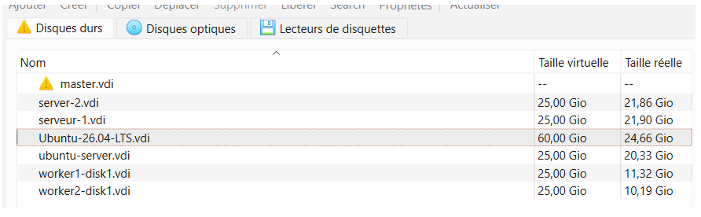
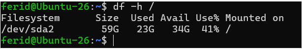
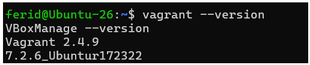
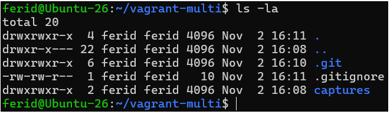

# TP Vagrant avancé (sans Ansible)

ISET Tozeur - Master DevOps & Cloud - Disponibilité des Infrastructures

## Objectifs
- Environnement multi-machines (web + db)
- Provisioning shell
- Réseau privé entre les deux VMs
- Mini-site PHP connecté à MySQL

## Préparation de l'environnement
Le disque de la VM Ubuntu-26 était plein (25 Go) : il a été agrandi à 60 Go.

## Étape 1 : Prérequis et dossier de travail

