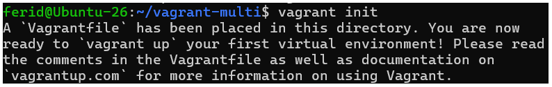
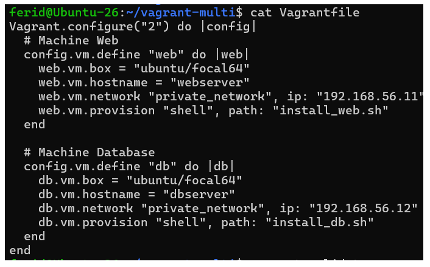
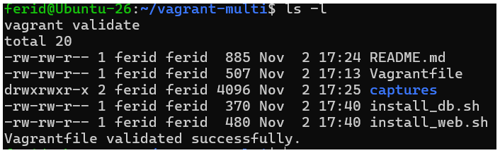
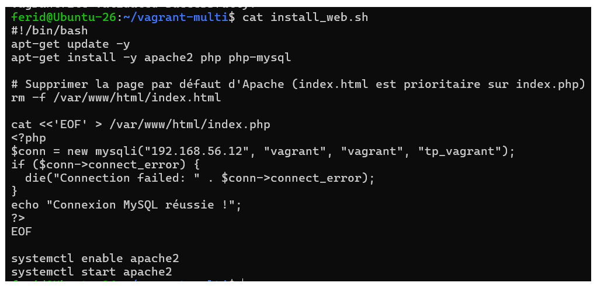
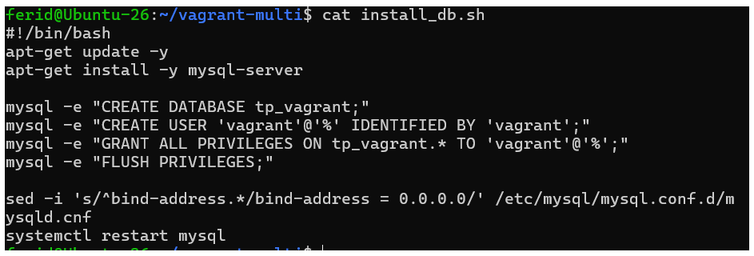

# TP Vagrant avancé (sans Ansible)

ISET Tozeur - Master DevOps & Cloud - Disponibilité des Infrastructures

## Objectifs
- Environnement multi-machines (web + db)
- Provisioning shell
- Réseau privé entre les deux VMs
- Mini-site PHP connecté à MySQL

## Préparation de l'environnement
Le disque de la VM Ubuntu-26 était plein (25 Go) : il a été agrandi à 60 Go.

## Étape 1 : Prérequis et dossier de travail

## Étape 2 : Création du Vagrantfile
Commande `vagrant init` :

Contenu du Vagrantfile (deux machines : `web` en 192.168.56.11 et `db` en 192.168.56.12) :

validation

## Étape 3 : Scripts de provisioning
Script `install_web.sh` (Apache, PHP, page de test) :

Script `install_db.sh` (MySQL, base `tp_vagrant`, utilisateur `vagrant`) :

